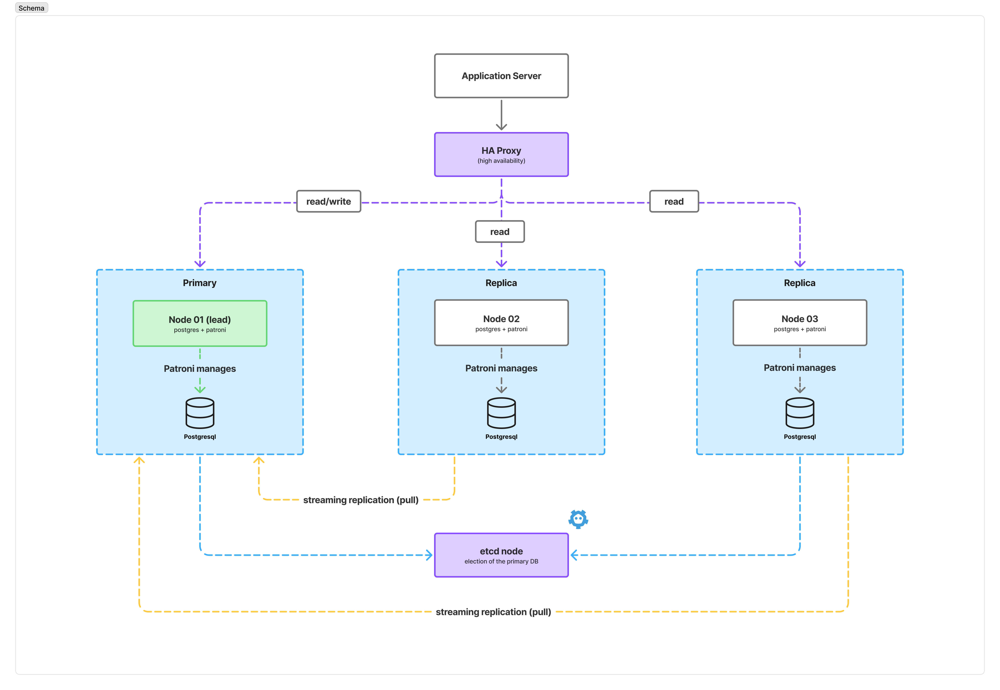

# Projektspezifikation: Hochverfügbarer PostgreSQL-Cluster

## 1 Worum es geht

Eine einzelne Datenbank ist ein Single Point of Failure: Fällt der Server aus,
steht die Applikation still. Dieses Projekt baut deshalb einen PostgreSQL-Cluster,
der den Ausfall eines Nodes automatisch übersteht — ohne manuellen Eingriff und
ohne dass bestätigte Transaktionen verloren gehen.

Der Cluster besteht aus drei PostgreSQL-Nodes (ein Leader, zwei Replicas), die
von Patroni verwaltet werden, einem etcd-Node für die Leader-Wahl und einem
HAProxy als einzigem Einstiegspunkt für die Applikation. Der gesamte Aufbau wird
mit Ansible automatisiert.

---

## 2 Ziele

| ID | Ziel |
|----|------|
| **Z-01** | Drei Nodes: genau ein schreibender Leader, zwei lesende Replicas. |
| **Z-02** | Automatischer Failover bei Ausfall des Leaders in ≤ 60 Sekunden. |
| **Z-03** | Kein Verlust bestätigter Transaktionen (RPO = 0). |
| **Z-04** | Die Applikation verbindet sich gegen einen einzigen, stabilen Endpunkt. |
| **Z-05** | Lesende Last geht an die Replicas, schreibende an den Leader. |
| **Z-06** | Ein zurückkehrender Node hängt sich automatisch als Replica an. |
| **Z-07** | Der Aufbau ist mit Ansible reproduzierbar und idempotent. |
| **Z-08** | Kein Split-Brain: nie akzeptieren zwei Nodes gleichzeitig Schreibzugriffe. |

---

## 3 Architektur



```
Application
     │
     ▼
  HAProxy  ──── :5000 (read/write) --> Leader
           └─── :5001 (read only)  --> Replica 1, Replica 2

  pg01 <-- streaming replication ── pg02, pg03
  pg01, pg02, pg03  <--- Leader-Key --->  etcd01
```

### 3.1 Komponenten

**HAProxy** ist der einzige Einstiegspunkt. Er fragt bei jedem Node nach, ob
dieser gerade Leader oder Replica ist, und leitet Schreibzugriffe (Port 5000) an
den Leader und Lesezugriffe (Port 5001) an die Replicas weiter. Nach einem
Failover folgt er der neuen Rollenverteilung von selbst.

**PostgreSQL-Nodes.** Es gibt immer genau einen Leader, der alle Schreibzugriffe
annimmt, und zwei Replicas, die seine Daten laufend übernehmen. Fällt der Leader
aus, wird eine Replica zum neuen Leader. Der alte Leader kommt später als
Replica zurück.

**etcd** ist die gemeinsame Wahrheitsquelle: Dort liegt ein Leader-Key, den der
aktuelle Leader regelmässig erneuern muss. Erneuert er ihn nicht mehr, wird der
Key frei und eine Replica übernimmt. So ist sichergestellt, dass es nie zwei
Leader gibt.

**Patroni** läuft auf jedem PostgreSQL-Node und ist der Cluster-Manager: Er
startet und stoppt PostgreSQL, hält den Leader-Key in etcd, entscheidet beim
Ausfall, welche Replica übernimmt, und gliedert zurückkehrende Nodes wieder ein.

### 3.2 Nodes

| Hostname | Rolle | Ansible-Gruppe | IP |
|---|---|---|---|
| `haproxy01` | Reverse Proxy / Load Balancer | `haproxy` | 10.10.0.10 |
| `pg01` | PostgreSQL + Patroni | `patroni` | 10.10.0.21 |
| `pg02` | PostgreSQL + Patroni | `patroni` | 10.10.0.22 |
| `pg03` | PostgreSQL + Patroni | `patroni` | 10.10.0.23 |
| `etcd01` | etcd | `etcd` | 10.10.0.30 |

Alle Nodes laufen auf Debian 13, erreichbar per SSH. Die Ansible-Control-Node
ist die Arbeitsstation und gehört nicht zum Cluster.

### 3.3 Was bei einem Ausfall passiert

Fällt der Leader aus, erneuert er den Leader-Key in etcd nicht mehr. Nach
spätestens 30 Sekunden verfällt der Key, die verbleibenden Nodes bemerken das,
und Patroni macht diejenige Replica zum neuen Leader, die am aktuellsten ist.
HAProxy erkennt den Wechsel über seine Health-Checks und leitet Schreibzugriffe
ab diesem Moment auf den neuen Leader. Insgesamt dauert das rund eine Minute.

Startet der ausgefallene Node später wieder, sieht Patroni, dass bereits ein
anderer Leader existiert, und hängt ihn automatisch als Replica an.

### 3.4 Wichtige Entscheide

| Entscheid | Wahl | Kurzbegründung |
|---|---|---|
| Replikation | synchron | Nur so gehen keine bestätigten Transaktionen verloren (RPO = 0). |
| DCS | etcd | Leichtgewichtig und von Patroni am besten unterstützt. |
| Verbindungsführung | HAProxy | Der Cluster meldet selbst, wer Leader ist — keine zweite Wahrheitsquelle. |
| Failback | keiner | Ein zurückkehrender Node bleibt Replica; das vermeidet einen zweiten Unterbruch. |
| etcd-Nodes | nur einer | Bewusste Vereinfachung für dieses Projekt, siehe Kapitel 6. |

---

## 4 Tests

Geprüft wird der Cluster im Wesentlichen über Patroni: **Mit Patroni wird
getestet, ob die Datenbanken laufen** und wer gerade Leader beziehungsweise
Replica ist. Ergänzend wird über den HAProxy verbunden und ein Node absichtlich
ausgeschaltet, um den Failover zu beobachten.

| ID | Test | Erwartetes Ergebnis |
|----|------|---------------------|
| **T-01** | Deployment | Playbook läuft fehlerfrei durch; ein zweiter Lauf ändert nichts mehr. |
| **T-02** | Cluster-Zustand mit Patroni prüfen | Ein Leader, zwei Replicas, alle laufen. |
| **T-03** | Replikation | Neue Daten sind kurz darauf auf beiden Replicas sichtbar. |
| **T-04** | Failover | Leader ausschalten: eine Replica übernimmt automatisch, Schreiben funktioniert nach rund einer Minute wieder, nichts geht verloren. |
| **T-05** | Rejoin | Der neu gestartete Node kommt von selbst als Replica zurück. |
| **T-06** | Geplanter Rollenwechsel | Switchover mit Patroni klappt mit nur kurzer Unterbrechung. |
| **T-07** | Endpunkte | Port 5000 landet immer beim Leader, Port 5001 immer bei einer Replica. |
| **T-08** | etcd-Ausfall | Der Cluster wird nur noch lesbar und erholt sich, sobald etcd zurück ist. |
| **T-09** | Split-Brain | Auch bei einer Netzwerktrennung akzeptiert nie mehr als ein Node Schreibzugriffe. |
| **T-10** | Erweiterung | Ein zusätzlicher Node über das Inventar erscheint als weitere Replica. |

Jeder Test wird im Projektbericht mit Kommando, Ausgabe und Zeitstempel
dokumentiert. Die Failover-Tests laufen über Skripte unter `tests/`, damit die
Messung reproduzierbar ist.

---

## 5 Bekannte Einschränkungen

| # | Einschränkung | Umgang |
|---|---|---|
| R-01 | etcd läuft nur auf einem Node und ist damit ein Single Point of Failure. | Bewusst akzeptiert und in T-08 vorgeführt. Produktiv wären drei etcd-Nodes nötig. |
| R-02 | Der HAProxy ist ebenfalls ein Single Point of Failure. | Ausserhalb des Projektumfangs; Lösung im Ausblick. |
| R-03 | Synchrone Replikation kostet Schreibleistung. | Bewusster Preis für RPO = 0. |
| R-04 | Kurze Netzunterbrüche können unnötige Rollenwechsel auslösen. | Patroni-Standardwerte statt Optimierung auf die kürzeste Ausfallzeit. |
| R-05 | Knappe Projektzeit für alle Tests. | Testfälle sind priorisiert: T-01 bis T-07 sind Pflicht, der Rest ergänzend. |

---

## 6 Ausblick

- etcd als Cluster mit drei Nodes — der wichtigste Schritt Richtung Produktion.
- HAProxy redundant mit Keepalived und einer virtuellen IP.
- Backup mit Barman oder pgBackRest: Hochverfügbarkeit schützt nicht vor einem
  versehentlichen `DROP TABLE`.
- Monitoring von Replikation, Leader-Wechseln und etcd.
- Connection Pooling mit PgBouncer.

---

## 7 Begriffe

| Begriff | Bedeutung |
|---------|-----------|
| **Leader / Primary** | Der Node, der Schreibzugriffe annimmt. Genau einer pro Cluster. |
| **Replica / Standby** | Node, der die Daten des Leaders übernimmt und nur Lesezugriffe erlaubt. |
| **Failover** | Ungeplanter Rollenwechsel nach einem Ausfall. |
| **Switchover** | Geplanter, kontrollierter Rollenwechsel. |
| **RTO** | Maximal tolerierte Ausfallzeit. |
| **RPO** | Maximal tolerierter Datenverlust; 0 heisst: keine bestätigte Transaktion geht verloren. |
| **DCS** | Verteilter Speicher für den Cluster-Zustand, hier etcd. |
| **Split-Brain** | Fehlerzustand, in dem zwei Nodes gleichzeitig Schreibzugriffe annehmen. |
